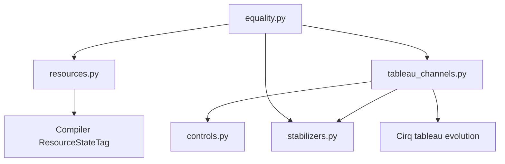

# Clifford channel verification

The sole public entry point is `cliffords_equal(left, right)`. It accepts two Cirq
circuits; there are no configuration arguments or boundary overrides. The circuits are expected to be Clifford operators with PPM, single-qubit Pauli measurements. T/T† resource preparations are recognized via `ResourceStateTag`, conditional S/S† corrections are handled via branching.

```python
import cirq
from resource_estimation.clifford_verification import cliffords_equal

a, b = cirq.LineQubit.range(2)
original = cirq.Circuit(cirq.CNOT(a, b))
optimized = cirq.Circuit(cirq.H(b), cirq.CZ(a, b), cirq.H(b))
assert cliffords_equal(original, optimized)
```

The result is `True` when equality is certified and `False` when supported circuits
are established to differ. Unsupported circuits or inconclusive resource-state
certification raise errors. Resource preparations use the PPM compiler gateset's `ResourceStateTag`.

## Usage

Inputs must be well-formed Cirq circuits using only dimension-two qubits.

- First-use resets identify prepared |0> ancillas, removing those logical inputs.
- Terminal ordinary `cirq.measure(q)` readouts consume their quantum outputs.
- Pauli parity measurements retain their quantum wires.
- Remaining inputs and outputs match by Cirq's default qubit order.
- With no boundary markers or resources, both circuits use the union of qubits;
  absent wires are idle.

Supported operations are:
- Unitary Cliffords 
- Signed Pauli parity measurements
- Initial ancilla resets
- Single-qubit Z readouts
- Single-qubit Pauli and S/S-dagger corrections controlled by affine conditions

Conditions may use a measurement key or Sympy Boolean symbols, XOR, NOT, and constants. Repeated
keys support Cirq's occurrence indices; records become available after their
measurement moment. Coherent Pauli correction phases must be fourth roots of unity.
Unsupported inputs raise errors rather than returning `False`.

Measurement records are discarded. Global and branch phases do not affect the
answer. To compare a retained classical result, copy it with a conditional X into
an extra |0> output wire, as demonstrated in the notebook. The checker does not
compare fault behavior, resource costs, or postselected/non-trace-preserving maps.

## Conditional S corrections

`cirq.S(q).with_classical_controls("m")` and its inverse are supported, including
indexed keys and affine XOR/NOT conditions. Only these extra Clifford corrections
are added; conditional H and other general conditional Cliffords remain unsupported.

The backend computes the condition into a record qubit, projects onto every
possible outcome, and applies a fixed S or identity in each case. Cirq performs
the projection and Clifford evolution. Deterministic conditions have one branch;
random conditions have two equally weighted branches. Their accumulated weights
are exact rational numbers. Repeated or correlated conditions may be deterministic
within a branch. Other measurement records remain coherent until the final trace.

With k conditional S gates there are at most 2^k branches. This path is intended
for circuits with one or two such corrections; it has no polynomial-cost guarantee.
Equivalent reduced states are merged after simulation. Channel equality uses the
exact squared Hilbert-Schmidt distance between weighted sums, computed from pairwise
stabilizer overlaps. It does not require individual branch decompositions to match.

Review `_split_record` and `channel_mixture` in `tableau_channels.py`, then
`stabilizer_overlap` and `channel_mixtures_equal` in `stabilizers.py`.

## T-state preparations

```python
import cirq
from resource_estimation.clifford_verification import cliffords_equal
from resource_estimation.compile_gateset.ppm_compiler import ResourceStateTag

data, resource = cirq.LineQubit.range(2)
# Declare a T-state preparation; do not apply a T gate to the circuit.
marker = cirq.I(resource).with_tags(ResourceStateTag(cirq.T, 0, 0, 1))
original = cirq.Circuit(marker, cirq.CNOT(data, resource))
optimized = cirq.Circuit(
    marker, cirq.H(resource), cirq.CZ(data, resource), cirq.H(resource)
)
assert cliffords_equal(original, optimized)
```

Only unconditional, single-qubit, Z-basis T/T-dagger compiler markers are accepted.
Use `cirq.T**-1` in the tag for T-dagger. The marker must be the wire's first use.
The tag is a preparation declaration for this verifier; ordinary Cirq simulation
still sees an identity operation.

Resources are replaced by open inputs and paired by state kind, then default
qubit order. Matching descriptors and equal open channels certify equality for
the supplied states. Different descriptors or unequal open channels raise
`NotCertifiedError`: the stronger proof failed, but those particular states may
still produce equal channels. There is no resource permutation search.

T gates and other non-Clifford data gates raise `NonCliffordError`.
Reset/H/T sequences are not resource declarations.

## Dependency/Reading Guide

Read these files in order:

| File | Responsibility |
|---|---|
| `__init__.py` | Exports only `cliffords_equal`. |
| `equality.py` | Entry point, logical boundaries, resource pairing, comparison. |
| `resources.py` | Recognize exact T/T† preparations and reject non-Clifford gates. |
| `controls.py` | Resolve measurement keys and affine Boolean conditions. |
| `tableau_channels.py` | Build a coherent Choi circuit and evolve it with Cirq. |
| `stabilizers.py` | Trace discarded wires and canonicalize signed stabilizer generators. |



## Tests and examples

```bash
python -m pytest resource_estimation/clifford_verification/tests -q
```

- `tests/equality_test.py`: public interface, boundaries, corrections, and errors.
- `tests/resources_test.py`: compiler markers, matching, and rejection semantics.
- `tests/controls_test.py`: measurement lookup and affine expression parsing.
- `tests/tableau_channels_test.py`: independent dense Choi and partial-trace
  calculations, signed measurements, adaptive corrections, and resource gadgets.

- [Quick start](examples/quick_start.ipynb): run the README examples, including tagged T-state preparations.
- [PPM rewrites](examples/cnot_ppm_verification.ipynb): display and verify the CNOT and GHZ rewrites, with negative controls and retained readouts.

[Benchmarks](benchmarks/README.md) time the current implementation; historical
results are kept separately and are not current performance claims.
